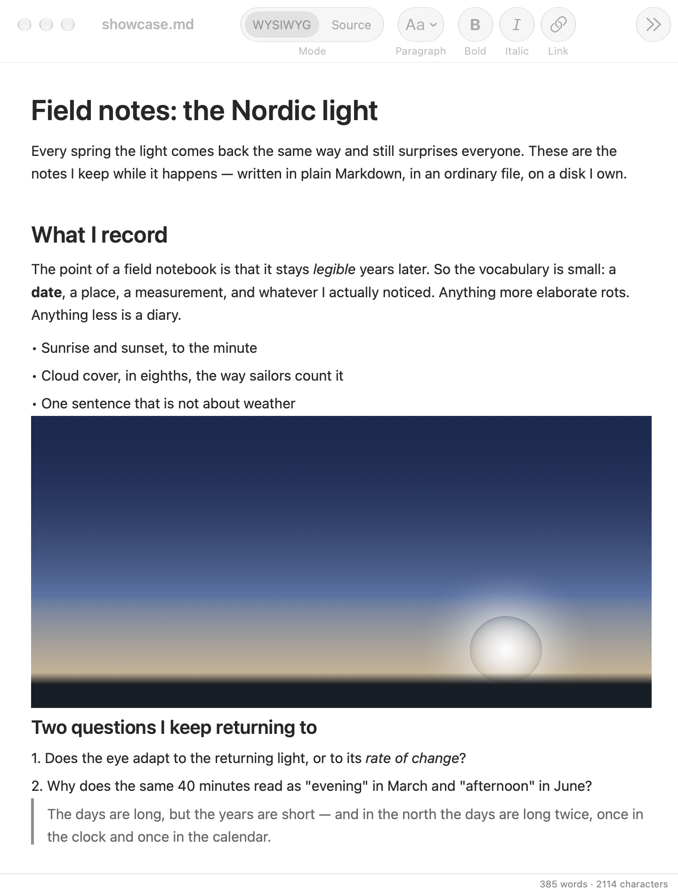

# Markdown Editor

A native macOS editor for ordinary Markdown files. Write in a live, delimiter-free view, or switch to
the literal source. The file on disk stays plain, standard Markdown that any other tool can open.

- **Your files, unchanged.** Plain UTF-8 `.md` files. No library, no database, no account, no
  lock-in.
- **Two views of one document.** A WYSIWYG view for writing and reading, and a live-styled Source
  view for the exact text on disk. Both edit the same source.
- **Standard Markdown.** GitHub Flavored Markdown 0.29, parsed by the pinned reference
  implementation (cmark-gfm).
- **A Mac app.** Documents, autosave, Versions, tabs, Recents, undo, spelling, Find, printing, and
  Light and Dark appearance, the way macOS apps work.
- **Images that stay safe.** Pasting or dropping an image copies it into an `assets/` folder beside
  the document and never touches the original.
- **Private.** Editing is entirely offline, with no telemetry. The only network request is the
  update check, which sends nothing about you or your documents.

More screens are in [docs/screenshots](docs/screenshots/README.md).

## Install

Download [Markdown-Editor.dmg](https://github.com/tonimelisma/Markdown-Editor/releases/latest/download/Markdown-Editor.dmg),
open it, and drag Markdown Editor to Applications. It needs macOS 27 or later.

The app is not notarized by Apple. The first time you open it, macOS says it can't check the
app. Click **Done**, open **System Settings → Privacy & Security**, click **Open Anyway**, and
confirm. After that it opens like any app and updates itself from
[GitHub Releases](https://github.com/tonimelisma/Markdown-Editor/releases).

## Development

The app is pure Swift: SwiftUI with narrow AppKit adapters, and TextKit for both editors.

- How to work in this repository: [CLAUDE.md](CLAUDE.md).
- Environments, CI and releases: [docs/DEVELOPMENT.md](docs/DEVELOPMENT.md).
- Product direction: [docs/VISION.md](docs/VISION.md).
- Architecture: [docs/ENGINEERING.md](docs/ENGINEERING.md).

The one check is `Scripts/check.sh`. Every pull request is built and tested on GitHub's macOS
runners, and every merge that changes the app is published as a release.

## License

[Apache License 2.0](LICENSE). The bundled cmark-gfm and Sparkle are under their own licences,
included in the app (`Markdown Editor/Licenses/`).
