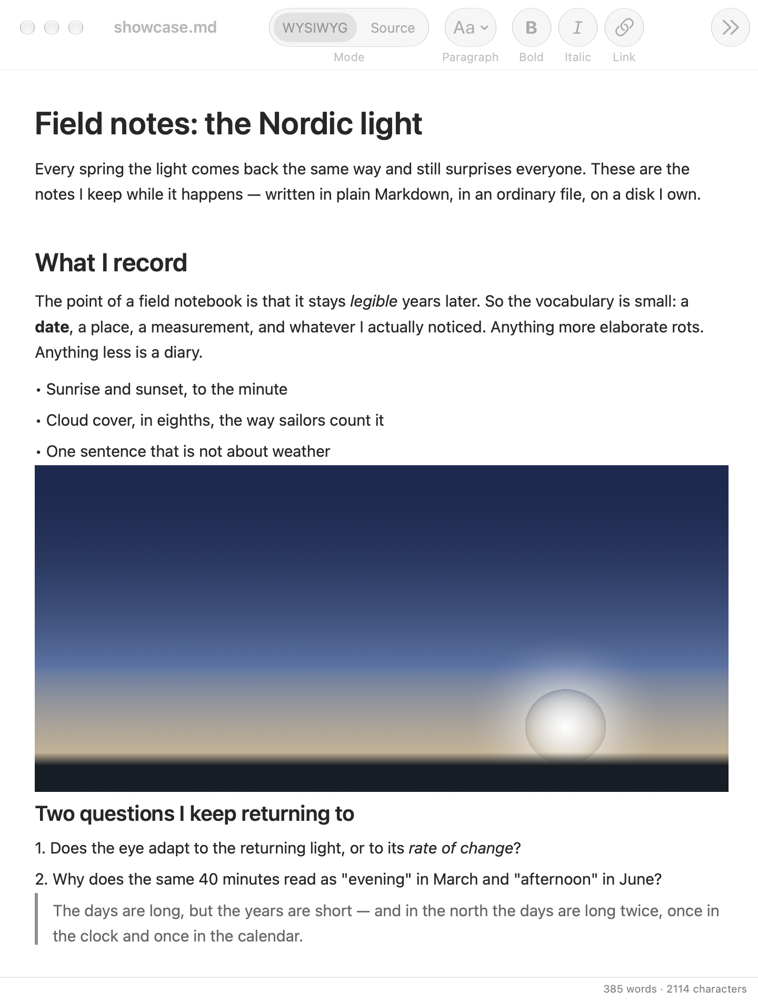
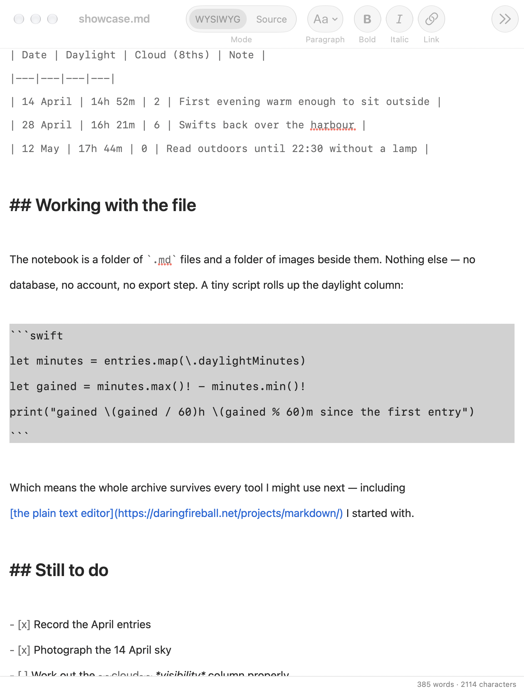
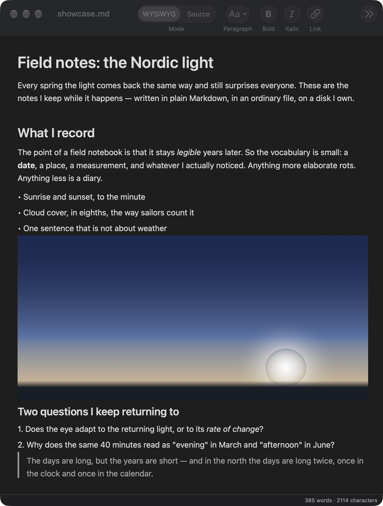
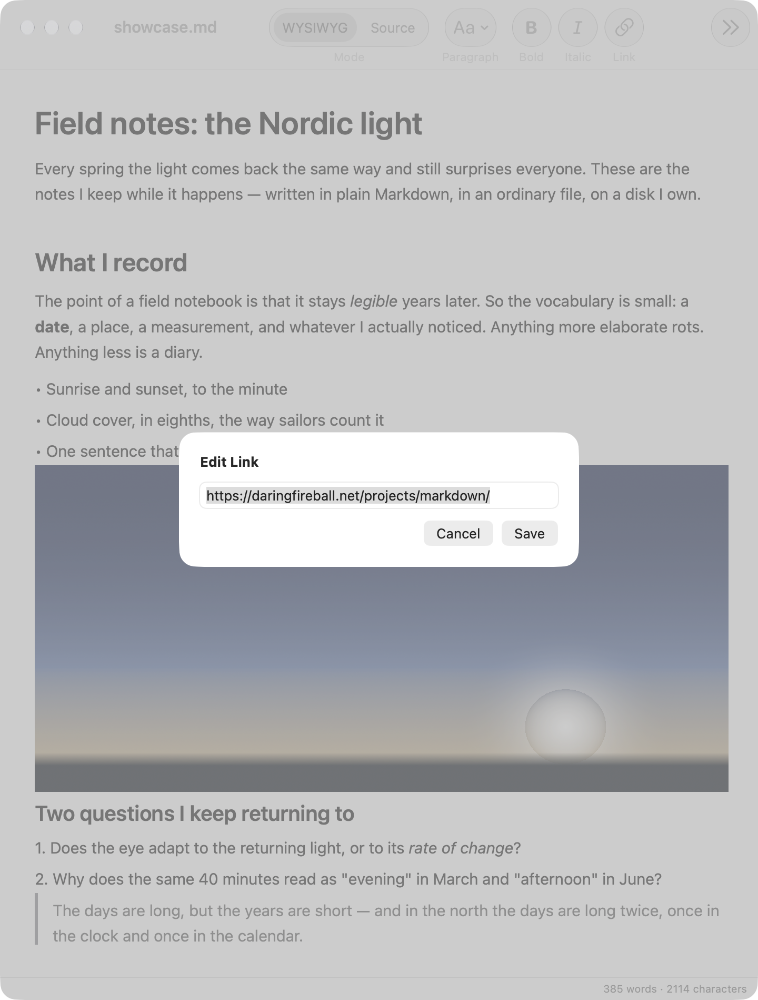
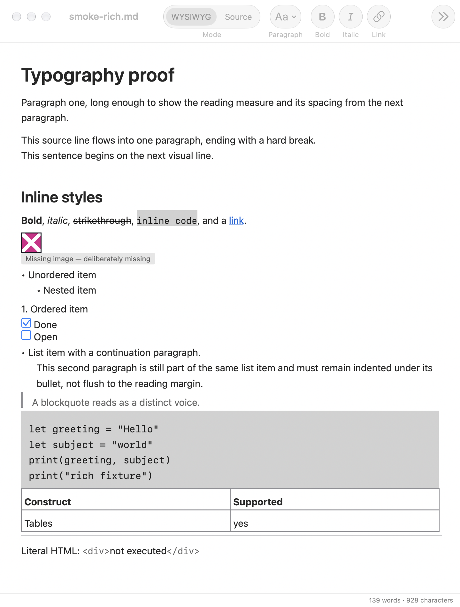

# Screenshots

Generated by `Scripts/screenshots.sh`. Do not edit by hand — regenerate instead.
Each image is one passive capture of the application's own window, taken after its
structured diagnostics proved the render was healthy. Fixtures live in
`Scripts/Fixtures/`.

## Reading and writing

The rendered reading surface, with the mode switch and the formatting toolbar. Delimiters are gone; the file on disk is unchanged.

`showcase.md` · scene `wysiwyg` · light appearance · 900pt window

## Source mode

The same document as literal Markdown, live-styled. This is the text that is actually on disk.

`showcase.md` · scene `source` · light appearance · 900pt window

## Dark appearance

The reading surface follows the system appearance, including image and code-block treatment.

`showcase.md` · scene `wysiwyg` · dark appearance · 900pt window

## Editing a link

Link editing is a window-attached sheet, opened over the selected link and prefilled with its destination.

`showcase.md` · scene `link-sheet` · light appearance · 900pt window

## Construct coverage

Headings, inline styles, a resolved image and a labelled missing one, nested and task lists, a quote, fenced code, a table, a thematic break, and literal HTML that is shown rather than executed.

`smoke-rich.md` · scene `wysiwyg` · light appearance · 1180pt window

